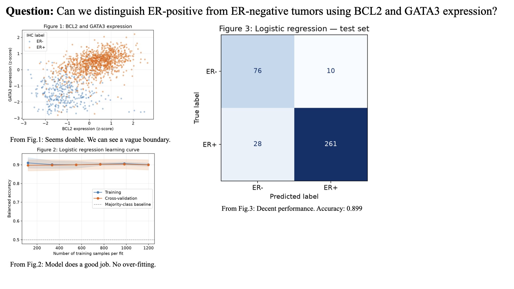

# Breast Cancer Gene Expression Analysis

## Introduction

Can we distinguish ER-positive from ER-negative tumors using **BCL2** and **GATA3** expression? This project uses their expression z-scores from the [METABRIC dataset](https://www.kaggle.com/datasets/raghadalharbi/breast-cancer-gene-expression-profiles-metabric) to predict estrogen receptor (ER) status measured by immunohistochemistry (IHC). The hypothesis is that logistic regression using these two features outperforms a majority-class baseline on held-out samples.

## Results

- **Figure 1:** ER-positive tumors generally have higher BCL2 and GATA3 expression, although the classes overlap.
- **Figure 2:** Training and five-fold cross-validation balanced accuracy stay close to **0.90**, with little separation between the curves. This suggests limited overfitting under this evaluation; increasing the training size produces little further improvement. Shading represents one standard deviation across folds.
- **Figure 3:** The model correctly classifies **337 of 375** test samples: 76 ER-negative and 261 ER-positive. It misclassifies 10 ER-negative and 28 ER-positive samples.

Test metrics calculated from the confusion matrix are:

| Model | Accuracy | Balanced accuracy |
|---|---:|---:|
| Majority-class baseline (always ER-positive) | 0.771 | 0.500 |
| Logistic regression | 0.899 | 0.893 |

These results support the hypothesis for this split, but do not establish causality or performance in other patient populations.



## Methods

1. Select `bcl2`, `gata3`, and `er_status_measured_by_ihc`. Convert expression values to numeric values and remove samples with missing or non-finite selected values. Encode `Negative` as 0 and the dataset's misspelled `Positve` as 1.
2. Make a stratified **80/20 train/test split** with `random_state=0`.
3. Fit a `StandardScaler` and `LogisticRegression(class_weight="balanced", max_iter=1000)` pipeline on the training set, plus a majority-class `DummyClassifier` baseline.
4. Generate the learning curve using five-fold stratified cross-validation within the training set. Scaling is fitted separately inside each training fold; the final test set is excluded.
5. Evaluate both models on the test set and save the three individual plots in `figures/`. The image above combines those plots into a summary slide.

To reproduce the individual plots, run these commands from the repository root:

```bash
python3 -m pip install pandas numpy matplotlib scikit-learn
mkdir -p dataset figures
```

Download `METABRIC_RNA_Mutation.csv` from the Kaggle link above and place it at `dataset/METABRIC_RNA_Mutation.csv`, then run:

```bash
python3 analysis.py
```

The script prints test metrics and writes `figure_1_gene_expression_scatter.png`, `figure_2_learning_curve.png`, and `figure_3_confusion_matrix.png` to `figures/`.
